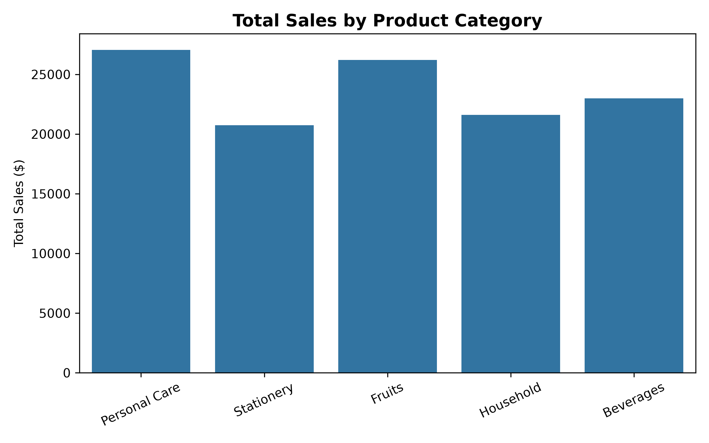

# 🛒 Supermarket Sales Analysis


### 📊 Project Overview
Analyzed 1000 supermarket transactions to identify top-selling product categories and sales trends using Python.

### 🔍 Key Insights
- **Top Categories:** Fruits and Personal Care generate highest revenue
- **Tools Used:** Python, Pandas, Matplotlib, Seaborn
- **Dataset:** 1000 transactions with product, price, gender, etc.

### 📈 Visualization


### 💻 How to Run
```bash
pip install pandas matplotlib seaborn
python analysis.py
